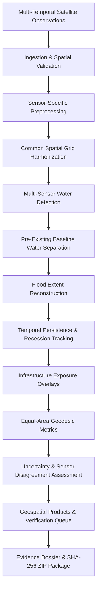
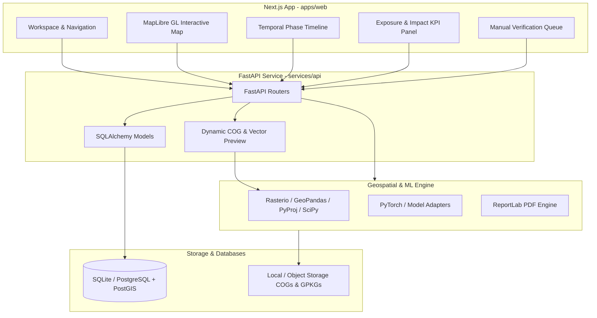

# Flood Impact Assessment — Multi-Sensor Flood Impact Evidence Platform

[]()
[]()
[]()
[](./LICENSE)
[-orange.svg>)](https://huggingface.co/datasets/ibm-esa-geospatial/ImpactMesh-Flood)

A production-quality open-source platform that **reconstructs, measures, and documents flood impact** using multi-temporal satellite observations from radar and optical sensors.

This is **not a predictive weather model or simple image viewer**. It is an **evidence engine** designed for disaster response agencies, insurers, geospatial engineers, and climate risk analysts who require traceable, scientifically defensible, and georeferenced evidence of inundation extent, temporal persistence, and infrastructure exposure.

---

## 1. Core Workflow



1. **Ingest Satellite Observations**: Collects scenes before, during, and after a flood event.
2. **Multi-Sensor Preprocessing**: Processes Sentinel-1 C-band SAR (dual-polarization radar) and Sentinel-2 optical imagery with Lee speckle filtering and cloud/shadow masking.
3. **Common Grid Harmonization**: Re-projects heterogeneous inputs to an aligned spatial grid with categorical vs continuous resampling safeguards.
4. **Permanent vs Newly Flooded Separation**: Isolates pre-existing baseline water bodies (rivers, lakes, reservoirs) so they are never conflated with new flood impact.
5. **Temporal Persistence**: Measures observed inundation duration across acquisitions and flags recession.
6. **Infrastructure Overlay**: Intersects inundation polygons with building footprints and road networks.
7. **Uncertainty & Disagreement**: Maps model entropy, cloud obstruction, and radar-optical sensor disagreements into an interactive human verification workflow.
8. **Reproducible Dossiers**: Generates executive PDF reports and self-contained georeferenced ZIP packages with cryptographic SHA-256 manifests.

---

## 2. Architecture & Tech Stack



- **Frontend**: Next.js 14, React 18, TypeScript, Tailwind CSS, MapLibre GL JS, Lucide icons.
- **Backend API**: Python 3.10+, FastAPI, Pydantic v2, SQLAlchemy, Uvicorn.
- **Geospatial Processing**: Rasterio 1.4+, GDAL, GeoPandas 1.1+, Shapely 2.0+, PyProj, PyOgrio, SciPy, Pillow.
- **Machine Learning**: PyTorch 2.14+, Model Adapter interface, Prithvi-EO-2.0-300M adapter, Clay adapter, Physical Baseline adapter.
- **Reporting**: ReportLab 5.1+ multi-page PDF generation engine.
- **Infrastructure**: Docker Compose (PostgreSQL 15 + PostGIS 3.3, Redis 7).

---

## 3. Dataset Integration — ImpactMesh-Flood

The platform integrates the **ImpactMesh-Flood** benchmark dataset published on Hugging Face by **IBM, DLR, and ESA Φ-lab** under **CC BY 4.0**.

- **Total Samples**: 24,578 samples across 206 global flood events.
- **Official Splits**: `train` (19,448), `validation` (2,171), `test` (2,959), `held_out` (562).
- **Leakage Prevention**: Enforces strict event-level partitioning — patches from held-out or test events are never exposed during training.
- **Selective Download Utility**: Prevents downloading the full 329 GB release by selectively pulling specific events within configurable disk budgets:

```bash
# Discover benchmark events in the catalog
python -m ml.datasets.impactmesh list-events --split test

# Selectively retrieve an event with a disk budget
python -m ml.datasets.impactmesh download \
  --events EMSR548_GER \
  --splits test \
  --max-download-gb 5.0
```

---

## 4. Machine Learning & Model Adapters

The system decouples geospatial processing from specific neural architectures using the `ModelAdapter` abstraction:

```text
ModelAdapter (Abstract Base Class)
    ├── BaselineWaterAdapter (Dual-pol SAR backscatter + NDWI/MNDWI + DEM slope)
    ├── PrithviAdapter (IBM-NASA Prithvi-EO-2.0-300M 3D ViT Flood Segmentation)
    └── ClayAdapter (Clay Tokenized Multi-Sensor Modality Adapter)
```

- **Hardware Acceleration**: Automatically selects CUDA, Apple Silicon MPS (Metal Performance Shaders), or CPU without crashing or assuming GPU availability.
- **Windowed / Tiled Inference**: Evaluates large satellite scenes via overlapping spatial tiles with cosine blending weights, keeping peak memory consumption low.
- **Probability Calibration**: Evaluates Brier score and Expected Calibration Error (ECE) across 10 confidence bins.

---

## 5. Quick Start & Developer Commands

### 5.1 Local Setup

```bash
# Setup Python 3.10 environment and install dependencies
make setup

# Run the complete demonstration workflow
make demo
```

The demo command initializes the **2021 Ahr Valley Flash Flood (EMSR548_GER)** benchmark event, executes the full multi-sensor reconstruction pipeline, generates the PDF report, and exports the georeferenced ZIP package.

### 5.2 Launch Services

```bash
# Start backend API (http://127.0.0.1:8000)
make run-api

# Start frontend application (http://localhost:3000)
make run-web
```

Open [http://localhost:3000](http://localhost:3000) in your browser.

### 5.3 Automated Tests & Quality Checks

```bash
# Run 21 automated unit and pipeline tests
make test

# Code quality check
make lint

# Frontend typecheck
make typecheck

# Verify adapter training loop
make train

# Verify evaluation metrics
make evaluate
```

### 5.4 Docker Compose Environment

```bash
# Spin up PostGIS and Redis
make docker-up

# Tear down
make docker-down
```

---

## 6. Generated Evidence Package Format

Every analysis run produces a reproducible, georeferenced ZIP package (`flood_evidence_<analysis_id>.zip`):

```text
flood-impact-evidence/
├── report.pdf                           # Executive multi-page PDF evidence dossier
├── rasters/
│   ├── preexisting_water.tif            # Baseline permanent water body (COG)
│   ├── maximum_observed_inundation.tif  # Peak newly inundated land extent (COG)
│   ├── temporal_persistence.tif         # Temporal fraction inundated [0-1] (COG)
│   └── uncertainty.tif                  # Composite uncertainty heatmap (COG)
├── vectors/
│   ├── inundated_regions.gpkg           # Georeferenced flood extent polygons
│   ├── affected_buildings.gpkg          # Building footprints with intersection %
│   └── affected_roads.gpkg              # Road centerlines with inundated length (m)
├── tables/
│   ├── event_summary.csv                # High-level area and exposure metrics
│   └── observation_metrics.csv          # Per-observation metric breakdown
├── metadata/
│   ├── event.json                       # Event metadata and spatial bounding box
│   ├── processing_configuration.json    # Exact analysis parameters used
│   ├── provenance.json                  # Sensor metadata, software versions, licenses
│   └── checksums.sha256                 # Cryptographic SHA-256 integrity manifest
└── README.md
```

---

## 7. Scientific Safeguards & Limitations

- **No Latitude/Longitude Multiplication**: Regional square kilometers are never calculated by multiplying degree dimensions. All geometric metrics are computed in equal-area projections (`EPSG:6933` / UTM).
- **Pre-Existing Water Safeguard**: A single pre-event observation establishes pre-existing water at that moment; historical water layers are used when continuous temporal baselines are required.
- **Exposure vs Damage**: Geographic intersection of a building footprint or road indicates _exposure_, not structural collapse, total financial loss, or impassability.
- **Sparse Temporal Observations**: Intermittent satellite passes establish observed inundation at discrete points in time; they cannot prove uninterrupted continuous flooding between passes.
- **Sensor Disagreements**: Where SAR and optical observations conflict, the discrepancy is highlighted in the Uncertainty Layer and escalated to the Manual Verification Queue.

---

## 8. License & Attribution

- **Source Code**: MIT License. See [LICENSE](./LICENSE).
- **ImpactMesh-Flood**: Released by IBM, DLR, and ESA Φ-lab under [CC BY 4.0](https://creativecommons.org/licenses/by/4.0/).
- **Copernicus Data**: Contains modified Copernicus Sentinel-1 SAR, Sentinel-2 Optical, and Copernicus EMS data (European Space Agency / European Commission).
- **Infrastructure Data**: Contains data from OpenStreetMap contributors ([ODbL](https://www.openstreetmap.org/copyright)).
