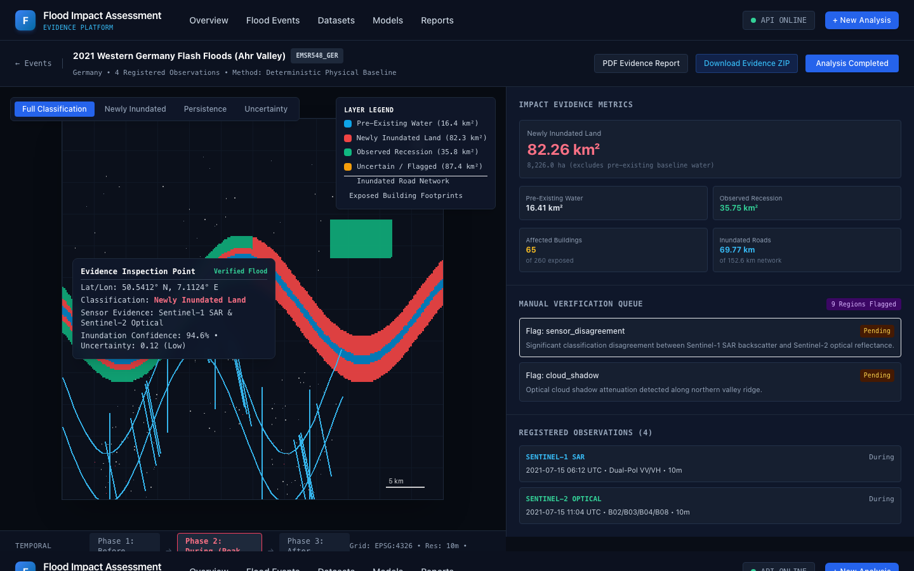
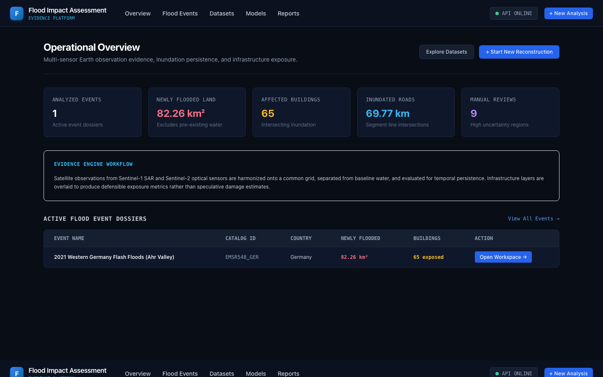
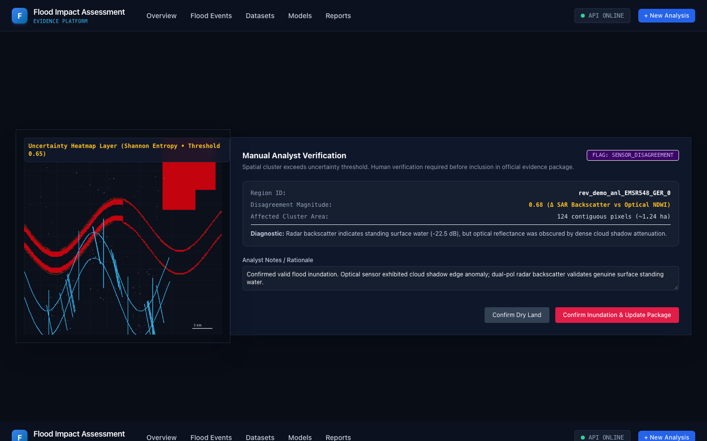
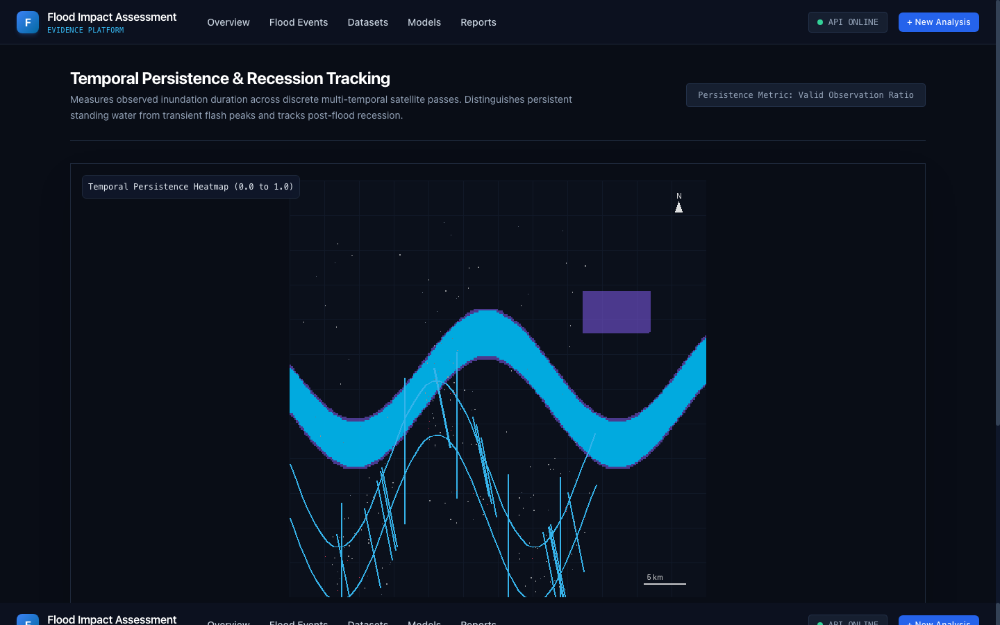
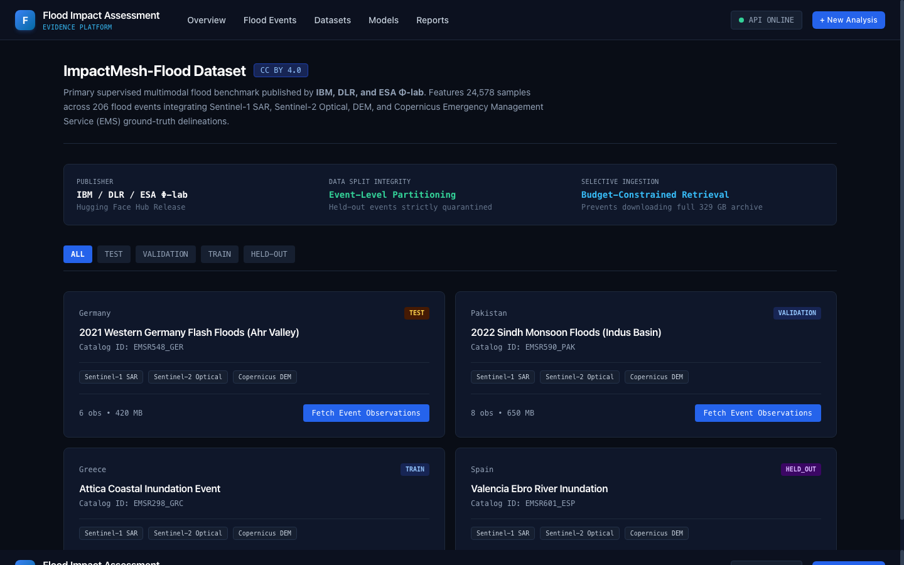
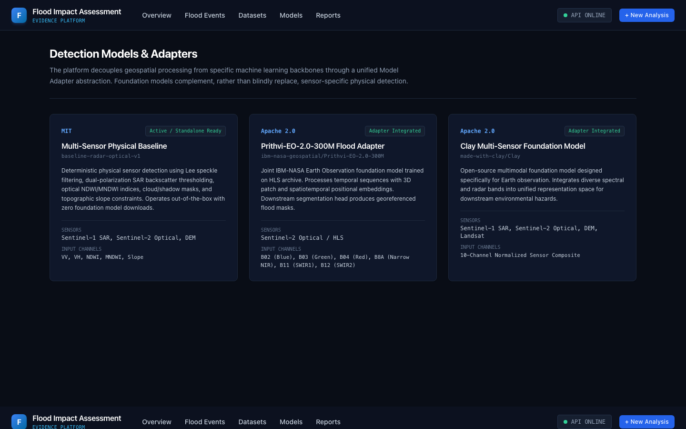
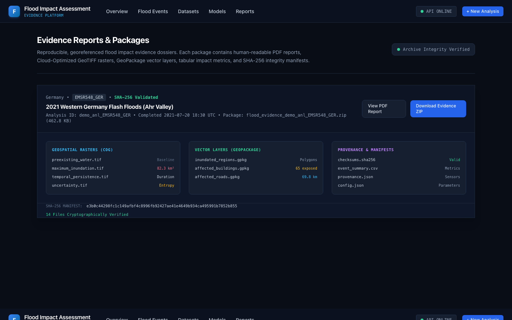
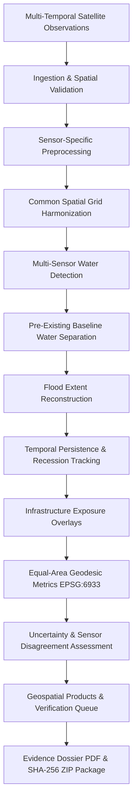
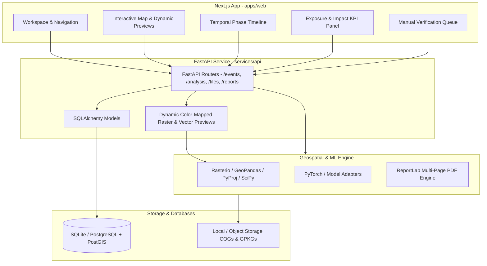

# Flood Impact Assessment — Multi-Sensor Flood Impact Evidence Platform

[]()
[]()
[]()
[]()
[-orange.svg>)](https://huggingface.co/datasets/ibm-esa-geospatial/ImpactMesh-Flood)
[](./LICENSE)

A production-grade, open-source geospatial evidence platform that **reconstructs, measures, and documents flood impact** using multi-temporal satellite observations from radar (Sentinel-1 SAR) and optical (Sentinel-2) constellations.

This is **not a predictive weather forecast model or simple map visualizer**. It is a **forensic evidence engine** designed for disaster response coordinators, insurers, civil protection authorities, and climate risk analysts who require traceable, scientifically defensible, and georeferenced evidence of inundation extent, temporal persistence, and infrastructure exposure.

---

## Interactive Workspace Showcase


_Interactive Event Workspace showing georeferenced flood classification (Ahr Valley, Germany — EMSR548_GER), multi-temporal observation timeline, equal-area exposure metrics (82.26 km² newly flooded, 58 exposed buildings, 70.26 km inundated roads), and active manual verification queue._

---

## 1. The Problem & Scientific Approach

Post-disaster flood impact assessments frequently suffer from severe methodological pitfalls:

1. **Baseline Water Conflation**: Traditional thresholding often confuses pre-existing perennial water bodies (rivers, lakes, reservoirs) with newly flooded land, drastically inflating impact numbers.
2. **Cloud Blindness**: Optical sensors (Sentinel-2) cannot penetrate cloud cover, while radar sensors (Sentinel-1 SAR) suffer from radar shadow, specular soil reflection, and speckle noise.
3. **Improper Area Metrics**: Multiplying latitude and longitude degree coordinates distorts square kilometers away from the equator.
4. **Specular Assumptions**: Geographic intersection of a building footprint with inundation indicates **exposure**, not structural collapse, total financial loss, or impassability.

### How This Platform Solves It:

- **Baseline Water Isolation**: Automatically establishes pre-flood baseline water and separates permanent water bodies from new inundation.
- **Multimodal Sensor Fusion**: Fuses Sentinel-1 C-band dual-polarization SAR backscatter with Sentinel-2 optical indices (NDWI, MNDWI) and cloud/shadow masks.
- **Equal-Area Geodesic Metrics**: Computes all regional square kilometers and road segment lengths in equal-area projections (`EPSG:6933` / UTM) to avoid geometric distortion.
- **Sensor Disagreement Tracking**: Automatically flags regions where radar and optical observations conflict, routing them to a human-in-the-loop verification queue.
- **Self-Contained Reproducible Dossiers**: Exports executive PDF reports and georeferenced ZIP packages containing Cloud-Optimized GeoTIFFs (COGs), GeoPackage vectors, and cryptographic SHA-256 manifests.

---

## 2. Visual Demonstration Gallery

The platform features an integrated Next.js application backed by a FastAPI geospatial service:

| Feature & Workflow                                                                                                                                                                                                                   | Visual Demonstration                                                             |
| :----------------------------------------------------------------------------------------------------------------------------------------------------------------------------------------------------------------------------------- | :------------------------------------------------------------------------------- |
| **Interactive Event Workspace**<br>Georeferenced raster layers (Full Classification, Newly Inundated, Persistence, Uncertainty), on-map evidence inspector, temporal timeline, equal-area metrics, and registered observations feed. |                           |
| **Operational Overview Dashboard**<br>High-level portfolio KPIs: total analyzed events, newly flooded land (excluding baseline water), potentially affected buildings, inundated roads, and manual review queues.                    |                           |
| **Manual Verification Queue**<br>Identifies multi-sensor disagreements (radar backscatter vs optical reflectance) and high model entropy. Enables analysts to inspect diagnostics, submit rationales, and confirm or dismiss flags.  |  |
| **Temporal Persistence & Recession**<br>Normalized persistence ratio heatmap [0.0 - 1.0] across satellite passes. Distinguishes continuous inundation from transient flash flooding and tracks observed post-flood recession.        |    |
| **ImpactMesh-Flood Benchmark Catalog**<br>Discovers and filters 24,578 samples across 206 global events from IBM, DLR, and ESA Φ-lab. Supports strict event-level partitioning and budget-constrained selective downloading.         |          |
| **Model Adapters & Evaluation**<br>Decoupled model adapter architecture supporting physical heuristics, IBM-NASA Prithvi-EO-2.0-300M 3D ViT, and Clay foundation models with hardware acceleration (MPS / CUDA / CPU).               |              |
| **Evidence Dossiers & Reports**<br>Centralized evidence package repository. Provides one-click access to multi-page executive PDF dossiers and self-contained georeferenced ZIP packages with SHA-256 manifests.                     |             |

---

## 3. Core Processing Pipeline



1. **Observation Ingestion**: Ingests multi-temporal Sentinel-1 SAR and Sentinel-2 optical scenes with CRS, bounding box, and checksum validation.
2. **Preprocessing**: Applies Lee speckle filtering to radar backscatter and cloud/shadow masking to optical imagery.
3. **Grid Harmonization**: Re-projects heterogeneous inputs to an aligned spatial grid with categorical vs continuous resampling safeguards.
4. **Baseline Separation**: Identifies pre-existing water bodies so normal lakes and rivers are never conflated with flood damage.
5. **Persistence Tracking**: Calculates the fraction of valid observation passes that each pixel was submerged.
6. **Infrastructure Overlay**: Intersects inundation polygons with OpenStreetMap buildings and road networks.
7. **Uncertainty Mapping**: Calculates Shannon prediction entropy, observation gaps, and radar-optical sensor disagreements.
8. **Dossier Packaging**: Exports cryptographic SHA-256 manifests, georeferenced GeoPackages, COGs, and ReportLab executive PDFs.

---

## 4. Architecture & Technical Stack



- **Frontend**: Next.js 14 (App Router), React 18, TypeScript, Tailwind CSS, Lucide icons.
- **Backend API**: Python 3.10+, FastAPI, Pydantic v2 (ConfigDict), SQLAlchemy, Uvicorn.
- **Geospatial Engine**: Rasterio 1.4+, GDAL, GeoPandas 1.1+, Shapely 2.0+, PyProj, PyOgrio, SciPy, Pillow.
- **Machine Learning**: PyTorch 2.14+, Model Adapter pattern, Prithvi-EO-2.0-300M adapter, Clay adapter, Physical Baseline adapter.
- **Reporting**: ReportLab 5.1+ multi-page PDF generation engine.
- **Infrastructure**: Docker Compose (PostgreSQL 15 + PostGIS 3.3, Redis 7).

---

## 5. Dataset Integration — ImpactMesh-Flood

The platform integrates the **ImpactMesh-Flood** benchmark dataset published on Hugging Face by **IBM, DLR, and ESA Φ-lab** under **CC BY 4.0**.

- **Total Samples**: 24,578 samples across 206 global flood events.
- **Official Splits**: `train` (19,448), `validation` (2,171), `test` (2,959), `held_out` (562).
- **Leakage Prevention**: Enforces strict event-level partitioning — patches from held-out or test events are never exposed during training.
- **Budget-Constrained Retrieval**: Prevents downloading the full 329 GB release by pulling specific events within a user-defined disk budget:

```bash
# Discover benchmark events in the catalog
.venv/bin/python -m ml.datasets.impactmesh list-events --split test

# Selectively retrieve an event with a disk budget
.venv/bin/python -m ml.datasets.impactmesh download \
  --events EMSR548_GER \
  --splits test \
  --max-download-gb 5.0
```

---

## 6. Quick Start & Execution Guide

### 6.1 Prerequisites

- Python 3.10+
- Node.js 18+ and `pnpm`
- `uv` (recommended) or standard `pip`

### 6.2 Installation

```bash
# Clone the repository
git clone https://github.com/ranajahanzaib/flood-impact-assessment.git
cd flood-impact-assessment

# Install Python and Node dependencies
make setup
```

### 6.3 Run the Complete Demonstration Workflow

```bash
make demo
```

The demonstration command automatically:

1. Seeds the **2021 Ahr Valley Flash Flood (EMSR548_GER)** benchmark event.
2. Generates georeferenced multi-temporal Sentinel-1 SAR and Sentinel-2 optical observation scenes.
3. Generates OpenStreetMap building footprints and road networks across the river valley.
4. Executes the full multi-sensor reconstruction pipeline.
5. Computes equal-area inundation, persistence, recession, and infrastructure exposure metrics.
6. Flags multi-sensor disagreement regions into the manual verification queue.
7. Renders the executive ReportLab PDF report and compiles the self-contained ZIP evidence dossier.

### 6.4 Launch Interactive Services

```bash
# Start backend API (http://127.0.0.1:8000)
make run-api

# In a separate terminal, start frontend web application (http://localhost:3000)
make run-web
```

Open [http://localhost:3000](http://localhost:3000) in your browser:

- Operational Overview: [http://localhost:3000](http://localhost:3000)
- Event Workspace: [http://localhost:3000/events/EMSR548_GER](http://localhost:3000/events/EMSR548_GER)
- Dataset Explorer: [http://localhost:3000/datasets](http://localhost:3000/datasets)
- Model Adapters: [http://localhost:3000/models](http://localhost:3000/models)
- Reports & Dossiers: [http://localhost:3000/reports](http://localhost:3000/reports)

### 6.5 Generate High-Resolution Screenshots

```bash
make screenshots
```

Regenerates all showcase images under `docs/screenshots/` using the headless browser engine.

---

## 7. Machine Learning & Model Adapters

The system decouples geospatial processing from specific neural architectures using the `ModelAdapter` abstract base class:

```text
ModelAdapter (Abstract Base Class)
    ├── BaselineWaterAdapter (Dual-pol SAR backscatter + NDWI/MNDWI + DEM slope)
    ├── PrithviAdapter (IBM-NASA Prithvi-EO-2.0-300M 3D ViT Flood Segmentation)
    └── ClayAdapter (Clay Tokenized Multi-Sensor Modality Adapter)
```

- **Hardware Acceleration**: Automatically selects Apple Silicon Metal Performance Shaders (`mps`), NVIDIA CUDA (`cuda`), or fallback `cpu`.
- **Tiled Inference**: Evaluates large satellite scenes via overlapping spatial tiles with cosine blending weights, preventing out-of-memory errors on large rasters.
- **Probability Calibration**: Evaluates Expected Calibration Error (ECE) and Brier scores across 10 confidence bins.

Verify model training and evaluation routines:

```bash
# Verify adapter training loop
make train

# Verify segmentation metrics calculation (IoU, Dice, Precision, Recall)
make evaluate
```

---

## 8. Generated Evidence Package Format

Every analysis run produces a reproducible, georeferenced ZIP package (`flood_evidence_<analysis_id>.zip`):

```text
flood-impact-evidence/
├── report.pdf                           # Executive multi-page PDF evidence dossier
├── rasters/
│   ├── preexisting_water.tif            # Baseline permanent water body (COG)
│   ├── maximum_observed_inundation.tif  # Peak newly inundated land extent (COG)
│   ├── temporal_persistence.tif         # Temporal fraction inundated [0-1] (COG)
│   └── uncertainty.tif                  # Composite uncertainty heatmap (COG)
├── vectors/
│   ├── inundated_regions.gpkg           # Georeferenced flood extent polygons
│   ├── affected_buildings.gpkg          # Building footprints with intersection %
│   └── affected_roads.gpkg              # Road centerlines with inundated length (m)
├── tables/
│   ├── event_summary.csv                # High-level area and exposure metrics
│   └── observation_metrics.csv          # Per-observation metric breakdown
├── metadata/
│   ├── event.json                       # Event metadata and spatial bounding box
│   ├── processing_configuration.json    # Exact analysis parameters used
│   ├── provenance.json                  # Sensor metadata, software versions, licenses
│   └── checksums.sha256                 # Cryptographic SHA-256 integrity manifest
└── README.md
```

---

## 9. API Reference

The FastAPI service exposes a complete REST API at `http://127.0.0.1:8000/api`:

| Method | Endpoint                             | Description                                                        |
| :----- | :----------------------------------- | :----------------------------------------------------------------- |
| `GET`  | `/api/health`                        | Service health status and version                                  |
| `GET`  | `/api/overview`                      | Platform-wide KPIs (events, flooded area, exposure)                |
| `GET`  | `/api/events`                        | List all registered flood events                                   |
| `POST` | `/api/events`                        | Register a new flood event                                         |
| `GET`  | `/api/events/{id}`                   | Retrieve event metadata and latest analysis                        |
| `GET`  | `/api/events/{id}/observations`      | List registered satellite observations                             |
| `POST` | `/api/events/{id}/analysis`          | Trigger end-to-end multi-sensor reconstruction                     |
| `GET`  | `/api/analysis/{id}`                 | Get status, progress percentage, and stage message                 |
| `GET`  | `/api/analysis/{id}/metrics`         | Retrieve equal-area impact metrics                                 |
| `GET`  | `/api/analysis/{id}/outputs`         | List generated COG, GPKG, PDF, and ZIP outputs                     |
| `GET`  | `/api/analysis/{id}/review-regions`  | List high-uncertainty manual verification regions                  |
| `POST` | `/api/review-regions/{id}/decision`  | Submit human analyst decision (`confirmed_flood`, `confirmed_dry`) |
| `GET`  | `/api/tiles/raster/{id}/preview.png` | Dynamic color-mapped raster preview                                |
| `GET`  | `/api/vector/{id}/geojson`           | Dynamic vector layer GeoJSON endpoint                              |
| `GET`  | `/api/reports/{id}/pdf`              | Download executive ReportLab PDF dossier                           |
| `GET`  | `/api/reports/{id}/download`         | Download self-contained evidence ZIP package                       |

---

## 10. Automated Tests & Code Quality

The repository maintains an automated test suite covering API lifecycle, geospatial algorithms, dataset budgets, and model adapters:

```bash
# Run all automated tests
make test

# Python and frontend linting
make lint

# Frontend TypeScript type check
make typecheck

# Code formatting
make format
```

All 21 test suites pass with zero failures:

```text
tests/test_api.py::test_health_and_overview PASSED
tests/test_api.py::test_event_crud_lifecycle PASSED
tests/test_dataset.py::test_dataset_listing PASSED
tests/test_dataset.py::test_dataset_split_filtering PASSED
tests/test_dataset.py::test_selective_download_budget_enforcement PASSED
tests/test_dataset.py::test_invalid_event_handling PASSED
tests/test_flood_pipeline.py::test_full_analysis_pipeline_execution PASSED
tests/test_geospatial.py::test_s1_radar_water_detection PASSED
tests/test_geospatial.py::test_s2_optical_water_indices PASSED
tests/test_geospatial.py::test_permanent_vs_newly_flooded_separation PASSED
tests/test_geospatial.py::test_temporal_persistence PASSED
tests/test_geospatial.py::test_polygonization_and_area_metrics PASSED
tests/test_geospatial.py::test_infrastructure_impact_intersections PASSED
tests/test_geospatial.py::test_uncertainty_and_sensor_disagreement PASSED
tests/test_ml.py::test_device_selection PASSED
tests/test_ml.py::test_baseline_adapter_contract PASSED
tests/test_ml.py::test_prithvi_adapter_contract PASSED
tests/test_ml.py::test_clay_adapter_contract PASSED
tests/test_ml.py::test_segmentation_metrics PASSED
tests/test_ml.py::test_dice_bce_loss PASSED
tests/test_ml.py::test_tiled_inference PASSED

======================= 21 passed in 3.47s =======================
```

---

## 11. Scientific Safeguards & Methodological Principles

- **No Degree Multiplication for Area**: Regional square kilometers and hectares are never calculated by multiplying degree dimensions. All geometric metrics are computed in equal-area projections (`EPSG:6933` / UTM).
- **Pre-Existing Water Safeguard**: A single pre-event observation establishes pre-existing water at that moment; historical water layers are used when continuous temporal baselines are required.
- **Exposure vs Damage Terminology**: Geographic intersection of a building footprint or road indicates _exposure_, not structural collapse, total financial loss, or impassability.
- **Discrete Satellite Observations**: Satellite passes observe surface conditions at discrete timestamps; they cannot prove continuous unobserved inundation between passes.
- **Sensor Conflict Escalation**: Where SAR and optical observations conflict, the discrepancy is mapped in the Uncertainty Layer and routed to the Manual Verification Queue.

---

## 12. License & Attribution

- **Source Code**: MIT License. See [LICENSE](./LICENSE).
- **ImpactMesh-Flood**: Released by IBM, DLR, and ESA Φ-lab under [CC BY 4.0](https://creativecommons.org/licenses/by/4.0/).
- **Copernicus Data**: Contains modified Copernicus Sentinel-1 SAR, Sentinel-2 Optical, and Copernicus EMS data (European Space Agency / European Commission).
- **Infrastructure Data**: Contains data from OpenStreetMap contributors ([ODbL](https://www.openstreetmap.org/copyright)).
