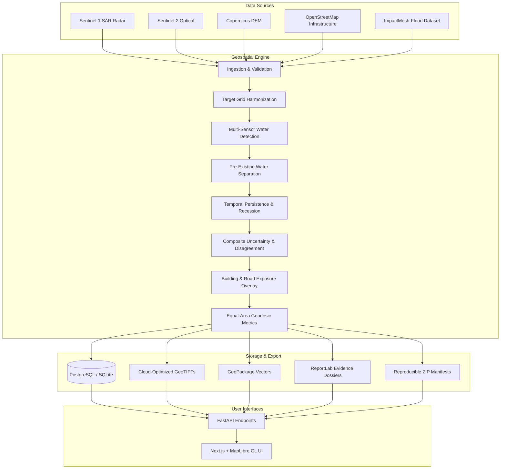

# Architecture Overview — Flood Impact Assessment Platform

## 1. System Vision

The **Flood Impact Assessment Platform** is a multi-sensor Earth observation evidence engine. Its primary objective is not predictive weather modeling, but rather the post-event and synoptic reconstruction, measurement, and georeferenced documentation of flood impact using multi-temporal satellite observations.

---

## 2. Core Architectural Pillars

### 2.1 Multi-Sensor Synergy

Optical satellite imagery (Sentinel-2) provides spectral reflectance indices (NDWI, MNDWI) but is severely obstructed by thick storm clouds and cloud shadows during major flood events. Synthetic Aperture Radar (Sentinel-1) penetrates clouds and precipitation through C-band active microwave radar, exploiting specular surface scattering to detect standing water. Combining both sensors ensures all-weather observation integrity.

### 2.2 Pre-Existing Water Separation

A permanent water body (e.g., lake, reservoir, regular river channel) must not be counted as newly inundated land simply because it appears wet in a during-event satellite scene. The platform enforces an explicit baseline water phase using pre-event acquisitions and historical context.

### 2.3 Equal-Area Projection Safeguards

Calculating surface area in square kilometers by multiplying geographic latitude and longitude degree deltas is mathematically invalid due to meridian convergence. The engine reprojects geometries and raster pixel boxes to an equal-area coordinate reference system (e.g., World Cylindrical Equal Area, EPSG:6933, or local UTM) for all area metrics ($m^2$, ha, $km^2$).

### 2.4 Traceability & Scientific Safeguards

Every metric, raster layer, and vector geometry in the generated evidence dossier includes a provenance manifest detailing input sensor IDs, acquisition timestamps, algorithm parameters, and SHA-256 file checksums.
